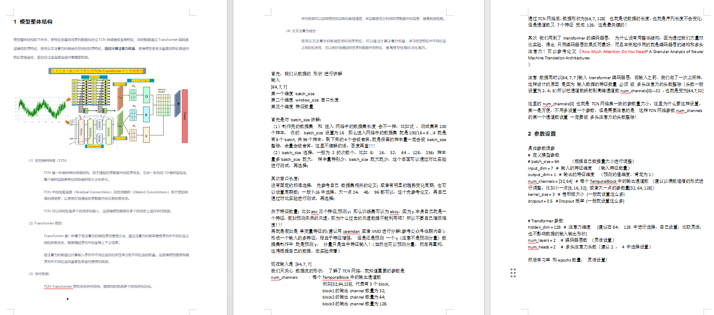
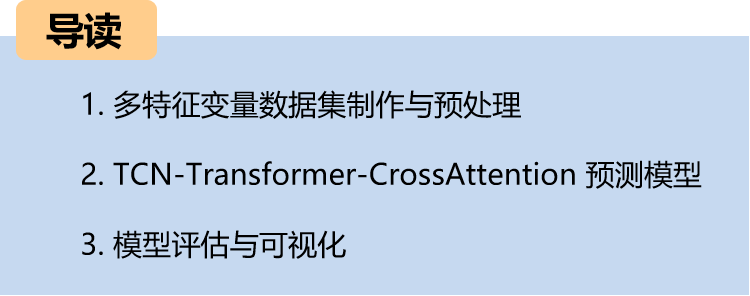
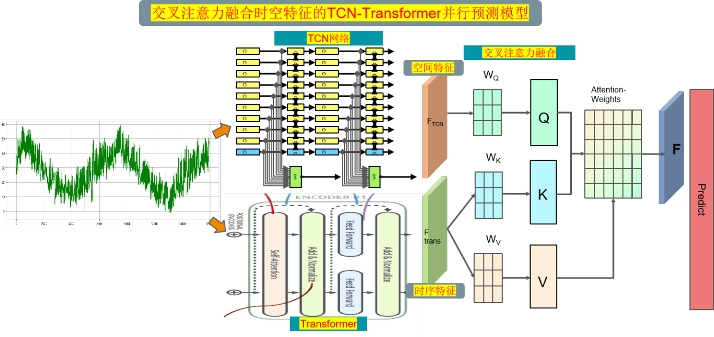
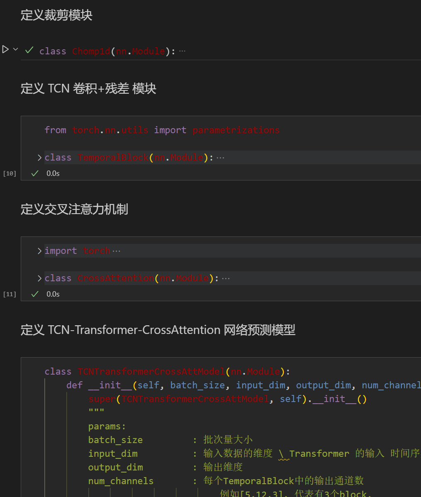
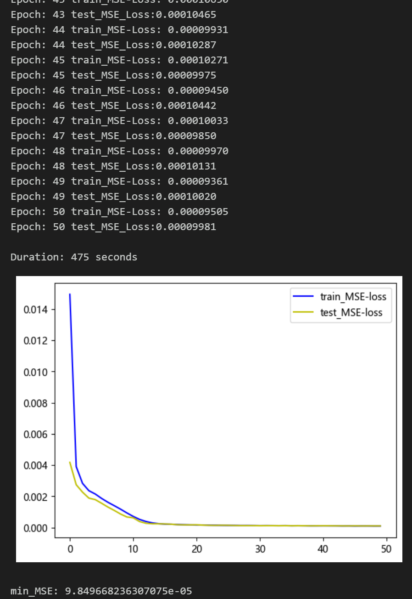
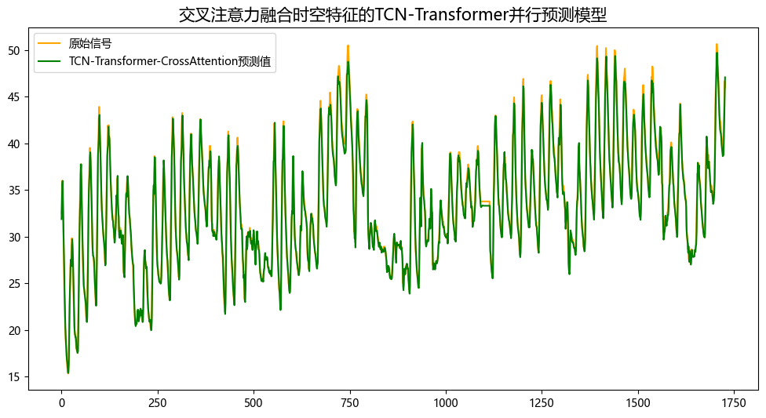
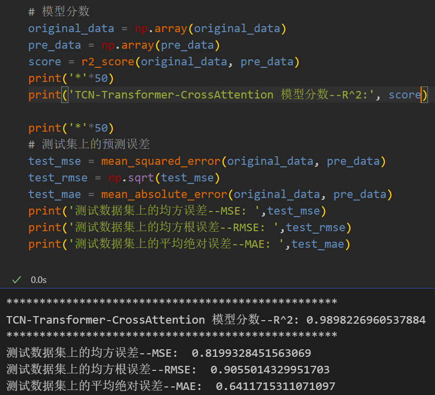
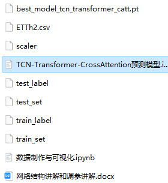

# Exclusive | High-Innovation Predictive Model

Cross-Attention Fusion of Spatio-Temporal Features in TCN-Transformer Parallel Prediction Models: Innovation!!!
Innovation Point:
1. Utilize the Time-Space Convolutional Network (TCN) to extract global spatial features of sequences, while leveraging the Transformer to extract temporal features of long-term dependencies within the sequences. The model employs a parallel structure to accelerate both training and inference speeds.
2. Utilize cross-attention for the fusion of spatiotemporal features in parallel networks, which can simultaneously consider both temporal and spatial relationships, thereby better capturing features within spatiotemporal sequences, enhancing feature representation capabilities to achieve high-precision predictions.
50 epochs, with minimal training error. The multi-variable feature TCN-Transformer-CrossAttention \tfusion network model has significantly improved prediction results. The model can fully extract spatial and temporal features from time series, achieving fast convergence and superior performance. The prediction accuracy is high, and the cross attention mechanism models the correlation between different features, extracting important features for model predictions from sequence-time features, resulting in significant improvements! Innovation also exists!!!
Environment: Python 3.9, PyTorch 1.8 and above are all acceptable.
\tNote: For this product, we also provide a model explanation (for learning network architecture) and parameter tuning explanation (to adjust parameters on your own dataset). Students with graduation projects or needing to write a small thesis paper should take note. The module is rich, innovative, and superior in performance!
\n        \n  
  
Preface
This paper introduces a TCN-Transformer parallel prediction model based on cross attention fusion of spatiotemporal features, which is introduced in the context of previous work on power transformers (dataset attached at the end). This aims to enhance the predictive performance of time series data.
This model is applicable to both multivariate feature and univariate sequence prediction.
1. Overall Structure of the Model
The overall structure of the model is as follows: multi-feature variable time series data first undergoes TCN network extraction of global features, while data also passes through Transformer encoder layers to extract temporal features. The cross attention mechanism is used to fuse spatial and temporal features. Through calculating attention weights, the model focuses more on important features before feature enhancement fusion, and finally, it goes through a fully connected layer for high-precision prediction.
(1) Spatiotemporal Convolutional Network (TCN):
A TCN is a type of convolutional neural network structure designed to capture the temporal relationships in time series data. It consists of a series of 1D convolutional layers, each with the same convolution kernel size and stride.
Residual connections and dilated convolutions in TCN are used to increase the network's receptive field, allowing better capture of long-term dependencies in time series data.
TCN can process multiple time steps simultaneously, enabling the model to make parallel predictions across multiple time steps.
(2) Transformer Model:
A Transformer is a sequence modeling method based on self-attention mechanisms, which models the dependencies between different positions in a sequence by computing the relevance between different positions in the input sequence. This allows the model to capture the global context information in the sequence.
The self-attention mechanism assigns different weights to different positions based on their relevance in the sequence. This enables the model to model and predict based on the importance of different positions in the sequence.
(3) Parallel Prediction:
The TCN-Transformer model adopts a parallel structure, capable of making simultaneous predictions for multiple time steps.
Parallel prediction can accelerate the training and inference speed of the model and fully utilize the information in the time series data, improving prediction performance.
(4) Cross Attention Fusion:
The use of cross-attention mechanisms to integrate spatial and temporal features allows for the calculation of attention weights, learning the correlation between different positions within the spatiotemporal features. This approach can better capture the characteristics of spatiotemporal sequences, thereby enhancing model performance and generalization capabilities.
2. Dataset Preparation and Preprocessing for Multi-Feature Variables
2.1 Import Data
2.2 Dataset Production
\tCreating dataset and classification labels
3 Cross Attention Mechanism
\t3.1 Cross Attention Concept
\tThe two sequences must have the same dimensions.
\tThe two sequences can be different patterns (such as: text, sound, image).
A sequence as input defines the output sequence length, and another sequence provides the input K&V.
3.2 Cross-attention Algorithm
\tCalculate K and V for S1.
Calculate Q for S2
\tCalculate the Attention Matrix Based on K and Q
\tApply V to the Attention Matrix
The output sequence length is consistent with S2.
During the fusion process, we use the temporal features through Transformer as the query sequence and the global spatial features extracted by TCN as key-value pairs. By calculating the attention weights between the query sequence and the key-value pairs sequence, we can model the correlation degree between different features.
4 Precision Prediction Model Based on TCN-Transformer-CrossAttention
4.1 Define the network model
4.2 Set parameters and train the model
50 epochs, with minimal training error. The multi-variable feature TCN-Transformer-CrossAttention integrated network model has significantly improved prediction results. The model is capable of fully extracting spatial and temporal features from time series data, achieving rapid convergence, superior performance, high prediction accuracy, and the cross attention mechanism can model the correlation between different features, extracting important features for model prediction from sequence spatiotemporal features, resulting in significant improvements!
4.3 Model Evaluation and Visualization
Visualization of Prediction Results
Model Evaluation
Prediction Results Visualization
Model Evaluation

Previously outstanding content:
Time Series Forecasting: Analysis and comparison of LSTM, ARIMA, Holt-Winters, SARIMA models
Wind Speed Forecasting (I) Data Set Introduction and Preprocessing
Wind Speed Forecasting (II) EMD-LSTM Model Based on PyTorch
Wind Speed Forecasting (III) EMD-LSTM-Attention Model
Wind Speed Forecasting (IV) EMD-Transformer Model Based on PyTorch
Wind Speed Forecasting (V) EMD-CNN-LSTM Model Based on PyTorch
Wind Speed Forecasting (VI) EMD-CNN-GRU Parallel Model Based on PyTorch
CEEMDAN + Combination Forecast Model (BiLSTM-Attention + ARIMA)
CEEMDAN + Combination Forecast Model (CNN-LSTM + ARIMA)
CEEMDAN + Combination Forecast Model (Transformer - BiLSTM + ARIMA)
CEEMDAN + Combination Forecast Model (CNN-Transformer + ARIMA)
Multi-Feature Variable Sequence Forecasting (I) - CNN-LSTM Wind Speed Forecasting Model

## Images

<!-- PAYMENT_BLOCK -->

## Get this dataset

- Payment link (Stripe): [Buy now](https://buy.stripe.com/3cs8yP7sY87d0vu9AB)
- Payment QR code: 

<!-- /PAYMENT_BLOCK -->
